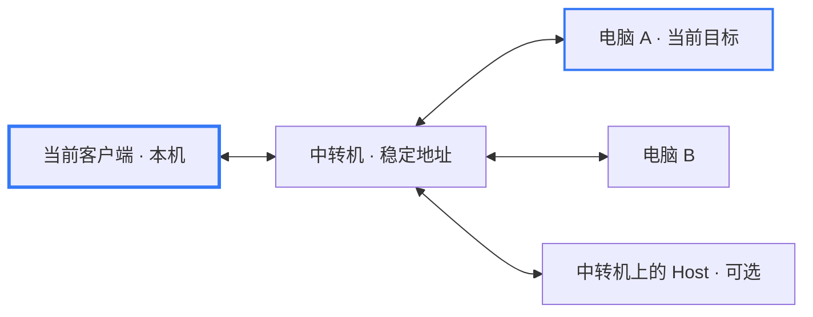

# ADR-0025: 内网中转与连接拓扑

- 状态: 已采纳（macOS 0.3.29）
- 日期: 2026-10-15

## 场景与边界

一台地址稳定的电脑提供中转，地址会变化的其他电脑主动连接它。客户端只需要知道
中转地址，再按稳定 Host ID 选择目标。IP 是连接地址，不是设备身份。

复用现有 Node Relay、Host 主动连接及配对协议，不创建另一套终端代理。
现有 `lan-app` 已启动 Relay + 本机 Host；当前缺少连接外部中转的服务模式和拓扑视图。
中转负责认证、在线连接和路由，Host 负责终端/文件/Agent。中转不启动或重启 Agent。

## Desktop 设置：独立能力

客户端连接、本机 Host 和 Relay 是可同时存在的能力，不使用互斥的整机角色。
「设置 → 内网服务」包含两个区块：

- **共享本机会话**：独立开关；选择「本机中转」或「另一台中转机」。外部中转填写地址、端口和密码，本机不开放入站端口。
- **为其他设备提供中转**：独立开关、监听 IP、端口和密码。停止本机共享不关闭中转；共享通过外部中转时，启停本机中转不影响共享。

主窗口的客户端连接独立于这两个开关。允许本机同时提供中转、向另一个中转注册 Host、作为客户端操作其他电脑。
共享使用本机中转时存在显式依赖：必须先开启中转；共享运行中禁用关闭该中转，并说明先停止共享或改用其他中转。
每项运行中仅锁定自己的配置；停止一项不会自动停止另一项。两个入口的配对信息分别放在对应区块。

`MacLANServices` 负责能力配置与依赖，两个 `MacLANService` 各自唯一拥有一个 supervisor，分别以 relay-only / join 启动。
Host 的目录和状态继续保留在原有 `LAN` scope；Relay 放在 `LAN/relay` scope。不迁移业务文件，不接管外部进程。
`LAN/services.json`（0600）保存各项最后成功配置与启用状态；显式关闭更新该项启用状态，退出 App 保留恢复意图。
配置文件不存在时才从旧 `connection.json` 迁移：direct → Relay + 本地共享；relay → Relay + 可选本地共享；join → 外部共享。
新格式存在但损坏或版本未知时保留文件并报告，不退回旧配置。失败/取消的启动不覆盖已保存端点和密码。

已有 `tb serve` 使用自己的资源和生命周期。端口已占用时立即提示修改端口或使用已有中转，不等待原服务退出后抢占。
启动 App Host 前使用已认证 roster 检查本机是否已注册，旧 Relay 也可避免常见重复启动。
随后 Host 使用 `hello.replaceExisting=false`；新版 Node/Cloudflare Relay 原子拒绝重复注册，保留原 Host 和客户端。
Host 的进程 UUID `hostInstanceId` 在重连时保持，新版 Relay 仅允许同实例替换自己的旧 socket，避免半开连接阻止恢复；标识不进入拓扑或清单。
旧 Relay 忽略该字段，因此旧服务的并发注册竞争只具备预检保护；需升级 Relay 才能获得原子拒绝保证。
App Host 被旧式客户端替换时停止并报告冲突，不反复重连争抢身份。客户端不发送 Host 专用字段。

所有接入者使用对应中转的密码，延续受信任网络语义。WS 沿用内网传输方式，不标为端到端加密。

## 拓扑交互

内网服务两个配置区块下提供可展开的「连接拓扑」，客户端的连接设置提供同一入口。桌面端先落地完整配置与
展示；所有客户端使用同一个拓扑契约，不为平台分别推断网络。

- 「本机」同时用文字、强调描边标识；高亮当前客户端 → 中转 → 当前 Host 的真实路径。
- 服务机视角高亮 Relay 或 Host；本机同时承担两种角色时明确标注，不按名称/IP 猜测合并。
- Host 节点可切换目标；不会通过图中的节点自动启动 Agent、修改网络配置或建立中转级联。
- 节点显示名称、角色、在线状态；多窗口属于同一客户端时合并展示连接数量。
- 断线后立即标为「连接中断，拓扑待刷新」，不把缓存继续显示为在线；旧中转明确显示
  「此中转尚不支持拓扑」，保留正常连接与会话功能。
- Android/iOS 使用相同的路径卡片和可展开设备列表，CLI 可用文本树表示；不强迫手机显示大画布。

## 权威数据与协议

Relay 是拓扑事实的唯一来源。仅在密码验证和 hello 完成后，向显式声明支持的连接发送
`relay_topology`；旧客户端不收到新事件，旧 Relay 忽略新的可选 hello 字段。

快照包含中转实例标识、生成时间、节点/连线、接收者自己的节点 ID、当前 Host ID 和截断
标志。Host ID 复用既有稳定身份；客户端实例 ID 只用于本次 App 运行期间多连接的展示合并，
不作为认证凭据。快照有数量和字符串上限，不包含密码、配对码、房间密钥、工作目录或会话内容。
只有已验证的在线 socket 可以进入快照。Node 与 Cloudflare 实现遵守同一线协议。

本机服务通过已有 supervisor IPC 接收 Relay/Host 的拓扑与重连状态，不另开管理端口。
Cloudflare 连接元信息持久化在 WebSocket attachment，休眠恢复后仍能重建拓扑。

## 生命周期与验收

App 分别拥有共享和中转 supervisor；每个 supervisor 管理自己的子进程及服务目录 lease。重复停止必须
幂等，启动取消、旧进程回调、端口冲突、Host 替换、网络断开都不得污染下一次运行。
纯中转允许没有 Host；接入失败不显示就绪；中转退出后其他机器的 Agent 保持运行。

验收覆盖：旧配置恢复、三种模式、两台 Host 接入、按 Host ID 路由、自己的节点、跨 Host
切换、断线/重连、重复 ID 替换、密码错误、未认证看不到拓扑、旧 Relay 降级，以及
Cloudflare 休眠恢复。用隔离服务和真实原生窗口验证；真实多机网络结果单独记录。

0.3.29 已发布初版三种角色配置；独立能力改版随 0.3.30 交付，不回改线上包。

## 本次验证与交付范围

Desktop 配置、服务端/客户端拓扑与本机高亮已实现。Node Relay 使用隔离的两个真实 Host
验证纯中转、主动接入、同一客户端多连接合并、断开清理、中转重启后恢复和失败配置不覆盖
已保存配置；Cloudflare 测试验证相同消息与 Host 替换。macOS 原生窗口通过打包 Runtime
验证三种角色中的中转/接入链路、实际 WebSocket 解码、自身节点、断开清图与重连，并截图核对。
全量 Node/PTY/Herdr fixture、macOS、Android 单测/Lint/构建与 iOS 核心测试通过。

Android/iOS 已同步模型与校验测试；移动端拓扑 UI 是后续工作。CLI 文本树与经已授权 Mac Peer 的自动配置见 [CLI 自动配置](../cli-automation.md)。
本轮网络验证在同一 Mac 的隔离进程进行，未声称真实多机/不同 Wi-Fi 网络验收。
macOS 设置页切换同时改为按需保留原生页面，避免反复重建和自动检测；窗口销毁时释放页面。

独立能力改版验收还覆盖：旧配置迁移、未知新格式不回退、同机中转与外部共享并存、独立停止、
本地依赖保护、应用退出恢复、启动取消、错误密码不覆盖配置、端口冲突保留原监听和并发 Host 注册拒绝。
