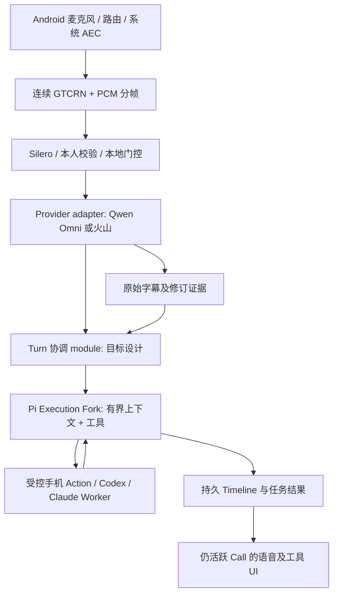

# Voice：连续音频与执行回执

2026-09-05。本次修复与后续设计分开标注；延续 ADR-0006 / ADR-0011，保留联网 Omni、Pi Execution Fork 和受控 Worker，不另加独立 ASR 或重写模型。

## 已确认根因与本次修复

### 音频增强没有保持流式状态

旧 Android 调用每 8 × 512 个采样（256ms）执行一次 `OfflineSpeechDenoiser.run()`。
sherpa-onnx v1.13.6 的 [offline 实现](https://github.com/k2-fsa/sherpa-onnx/blob/v1.13.6/sherpa-onnx/csrc/offline-speech-denoiser-gtcrn-impl.h)
在每次 Run 创建 STFT、IStft，并调用 `GetInitStates()`。因此不是模型本身无状态，而是调用方式每块重新开始。
[online 实现](https://github.com/k2-fsa/sherpa-onnx/blob/v1.13.6/sherpa-onnx/csrc/online-speech-denoiser-gtcrn-impl.h)
把频谱流和 recurrent states 保存在对象里，现有 AAR 已提供，无须新增依赖。

本次将 `OnDeviceVoiceModels` 改为 `OnlineSpeechDenoiser`：每 512 个采样输入，按通话持有状态；
`StreamingDenoisedFrames` 只拼接真正的模型输出，不再用原音填补推理延迟。完成时 flush，最后不足一帧才补零；新捕获 reset。
同一份净化 PCM 用于 clean VAD 和云端上行，模型异常不静默切换成混合原音。

### 工具身份依赖字幕时序

原 Host requestId 使用最新 `userSequence`，而工具与最终字幕到达先后并不稳定：
工具先到时可能与上一轮共享 requestId；长 requestId 截断还可能丢失唯一后缀。
现改为 `voice-exec-<sha256(JSON.stringify([voiceRequestId, callId]))>`，不依赖字幕计数。
这是工具执行身份，不是假定已完成 input item 与 response 的完整关联。

Omni adapter 现在在异步调用前认领 `callId`，重复的同 ID 事件不再重复执行/回传/触发续答。
Host 异步工具结束时，仅当前仍活跃的 Call 能收到通话 UI 状态；持久任务与通话生命周期分离。
该去重限定单次 provider 会话、同一 callId；不同 callId 的语义重复尚不合并。

## 目标结构

职责：Android 保证连续声音，不负责技术词硬改；provider adapter 保留原始识别/事件身份；
Fork 理解当前 Agent、图片和任务语境并执行工具；Timeline 保存事实，不以正在播放/挂断决定任务是否存在。

## 下一步：Turn 协调 module（尚未实现）

生产 prompt 要求每个实质性请求调用一次 `fork_execution`，但真实回放出现字幕正确、
模型直接回复“请问您现在需要我执行这个操作吗？”而无工具调用。不是网络离线或 ASR 没字。

Turn 协调 module 应把 `input itemId → responseId → callId → taskId` 关联起来，独立于显示文本：

1. 区分听到、已接受、等待派发、执行中、完成、拒绝、取消和缺失回执；不能用一个 working 概括。
2. 工具早于 final 时保留提案，关联到其输入，先检查回声/取消，再产生副作用。
3. 已接受但未派发必须显式可恢复；模型重试和兜底共用一次执行身份，不能 timer + lastText 再派一遍。
4. 模型原音理解可能把 SKU 纠回 Skill；兜底不能悄悄用错误字幕替代原音理解，需对两条路径消融。
5. 旧 response.done 不得清空新 response；工具完成遇到用户说话需排队，不得抢话。
6. Host 主动通知使用独立输入身份，不消耗/复用用户最近一次字幕的编号。

另一个待验证风险：`OnDeviceVoiceCapture.emitPassthrough` 仍有约 10 秒连续 audible 后
强插约 2 秒静音的历史保护逻辑。它可能切掉长句，和“云端负责语义判停”有冲突；本次只修
降噪状态，没有用短句结果擅自删除该抗持续噪声保护。需真实长句/风噪配对回放后替换。

验收必须覆盖 final/tool 乱序、重复 call、同 turn 不同 call、旧 response 迟到、无 final、无工具、
回声拒绝、挂断后完成及长 ID。上述完整状态机不是本次去重补丁已经解决的能力。

## 上下文与字幕策略

- 分开保留 raw ASR、应用展示字幕、实际 Fork 输入；不能覆盖原文后再声称 ASR 正确。
- 不新增“缩放 → Skill”替换表。术语必须有语音/预览/当前相关场景证据。
- 给 Fork 的 Agent/完成时间/当前图片用权威有界快照；不给所有 History/Memory 无差别灌入语音 prompt。
- 通用热词、当前页面相关词、会话摘要分别测；两句合成语音不足以决定删掉哪类上下文。

## 2026-09-05：停顿续说与中断历史补测

已实现、已通过代码测试的部分：

- Host 按回复稳定 ID 每 250ms 合并一次语音文字检查点；正常结束写 `completed`，
  生成中打断/挂断写 `interrupted`。Android/iOS 可以显示这些标签；迟到 final 不能复活旧记录。
- 百炼按 response ID 忽略已经结束或被后续回复取代的事件；不再让旧 `response.done`
  结束新回复。重建上下文暂时排除 streaming/interrupted 的 AI 回答，用户原话保留。
- 没有实际播放游标：`completed` 是生成完成，不保证已经全部听到；尚不能精确截取“已听到前缀”，
  也没有假定百炼支持未文档化的 `conversation.item.truncate`。

未通过实测、默认关闭的部分：

`experimentalTurnContinuation` 注册内部 `wait_for_user`，缓存不完整前句，关联
input item/response，再从已接受的字幕构造工具参数，禁止把模型自己写的回答当用户原话。
但这仍依赖 Omni 主动交接工具，不能作为产品级 TurnCoordinator。

用 macOS Tingting 合成“我最近的”与“Agent 是什么”，中间插入 2.6 秒静音，PCM16LE/16k/mono，
对实际 qwen3.5-omni-flash-realtime 进行了四组、每组两次回放；Fork 为无副作用 mock。
第一组一次丢前句、一次无工具；第二组一次参数混入模型自己写的定义、一次无工具；
第三、四组各两次都字幕正确却无工具，55 秒验收超时。
最后两组 ASR 字符错误率为 0，但工具交接成功率 0/4。这是合成样本结果，不代表总体成功率。
由此不能声称续说已修复，实验参数未在 Host 开启。

后续需要在执行前引入受控的完整性/续说判定与稳定 turn ID，明确无工具时的恢复路径，
而不是用 `tool_choice=required`（实时接口不支持）或 timer + lastText 重复派发。
保留 Omni 原生音频链路，不凭该实验另接独立 ASR/TTS 或关键词硬替换。

端侧核查：`BrainActivity.startVoiceCapture` 当前 `verifySpeaker=false`，Call 使用 passthrough；
GTCRN/Silero 负责降噪与人声门控，不等于识别主人。CAM++ 校验曾因空 embedding 卡住，
且 passthrough 早返回绕过旧校验路径。恢复本人识别需要单独验证失败恢复、缓存预卷音频、
主人与电视混音、误拒绝率，不能只把布尔开关改成 true。

参考：[百炼客户端事件](https://help.aliyun.com/zh/model-studio/client-events)、
[实时工具能力边界](https://help.aliyun.com/zh/model-studio/qwen-function-calling)。

## 验证边界

详见 [实测结果](voice-ablation-results.md) 与 [复现方法](voice-ablation.md)。
已通过原生库分块不变性、PCM 拼帧、同 callId 去重/关闭后不续答、长 requestId 身份测试。
没有车内真实录音，没有三星听感/蓝牙/长句/连续多轮验收；未安装或重启生产 Host。
